<div class="muted small">DATABASE CONCURRENCY · READING CLUB</div>

# Generalized Isolation Levels

A graph-based way to define what “isolated” means

<div class="muted mt-12">
Atul Adya · Barbara Liskov · Patrick O’Neil<br/>
ICDE 2000
</div>


---

# What problem is the paper solving?

<div class="grid grid-cols-2 gap-6 mt-4">
<div class="box">

**ANSI SQL-92**

Isolation levels were defined by a small set of *phenomena* (dirty read, non-repeatable read, phantom), written in English.
The definitions were ambiguous and missed some bad executions.

</div>
<div class="box">

**1995 critique (Berenson et al.)**

Phenomena P0–P3 fixed the ambiguities, but they forbid *overlapping operations*. In effect they are “disguised versions of locking”.

</div>
</div>

<div class="mt-6">

**Goal:** precise guarantees that work with locking, MVCC **and** optimistic concurrency control, and that handle predicates correctly at every level.

</div>

---

# Notation used in the paper

<div class="grid grid-cols-2 gap-8">
<div>

| Event | Meaning |
|---|---|
| `w1(x1)` | T1 writes x, producing version x1 |
| `w1(x1:2)` | T1’s 2nd write of x |
| `r2(x1, 5)` | T2 reads version x1, value 5 |
| `r2(P: x1, y0)` | T2 runs a predicate read; its version set is {x1, y0} |
| `c1` / `a1` | T1 commits / aborts |
| `[x1 ≪ x2]` | version order: x1 comes before x2 |

</div>
<div>

A history is read left to right:

```text
H1: r1(x,5) w1(x,1) r2(x,1) r2(y,5) c2
    r1(y,5) w1(y,9) c1
```

Invariant used in the examples: **x + y = 10**

<div class="muted small mt-4">
Being able to read this notation makes the rest of the paper much easier to follow.
</div>

</div>
</div>

---

# The 1995 phenomena and their locking origin

```text
P0: w1[x] ... w2[x] ... (c1 or a1)        dirty write
P1: w1[x] ... r2[x] ... (c1 or a1)        dirty read
P2: r1[x] ... w2[x] ... (c1 or a1)        fuzzy / non-repeatable read
P3: r1[P] ... w2[y in P] ... (c1 or a1)   phantom
```

| Level | Forbids | Read locks | Write locks |
|---|---|---|---|
| Degree 0 | — | none | short |
| READ UNCOMMITTED (Degree 1) | P0 | none | long |
| READ COMMITTED (Degree 2) | P0, P1 | short | long |
| REPEATABLE READ | P0–P2 | long on items, short on predicates | long |
| SERIALIZABLE (Degree 3) | P0–P3 | long | long |

<div class="small muted">Long lock = held until commit/abort. Short lock = released right after the operation. (Paper, Fig. 1)</div>

<!--
Each "..." in P0–P3 means "while the first transaction is still running". That is exactly what a lock
held until commit prevents, which is why the paper calls these definitions locking in disguise.
-->

---

# Preventing an overlap ≠ preventing a bad outcome

<div class="grid grid-cols-2 gap-8">
<div>

```text
time  T1               T2
 │    read x  → 5
 │                     write x = 9
 │                     commit
 │    read x  → ?
 ▼    commit
```

<div class="small muted">P2 forbids this interleaving outright.</div>

</div>
<div>

<div class="box">

**Preventive rule (P2)**
Block or reject the overlap itself, even if the committed result could be serialized.

</div>
<div class="box">

**Generalized rule**
Let operations overlap. Check whether the *committed* dependencies form a forbidden pattern.

</div>

With MVCC, T1 can read the old version of x both times. The result is then equivalent to **T1 ; T2**.

</div>
</div>

---

# Same overlap, different outcome

T1 moves 4 from x to y. Invariant **x + y = 10**, start x = 5, y = 5.

<div class="grid grid-cols-2 gap-8">
<div>

**H1**: bad

```text
T1: write x = 1
T2: read x → 1
T2: read y → 5      sum = 6  ✗
T2: commit
T1: write y = 9
T1: commit
```

</div>
<div>

**H1'**: fine, equivalent to T1 ; T2

```text
T1: write x = 1
T1: write y = 9
T2: read x → 1
T2: read y → 9      sum = 10 ✓
T1: commit
T2: commit
```

</div>
</div>

Both read T1’s uncommitted x, so **P1 bans both**. Only H1 is actually wrong.
(P2 has the same problem; see H2 / H2' in §3 of the paper.)

**Root cause:** P0–P3 are *single-object* rules guarding *multi-object* invariants, so they must over-restrict.

---

# The model: objects, versions, transactions

One logical object `x` has many versions:

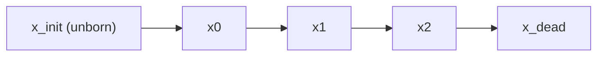

- Every write creates a new version. A commit **installs** the transaction’s final versions.
- `T_init` conceptually creates *every* object that will ever exist, as an unborn version.
  INSERT then becomes a version change: unborn → visible.
- DELETE installs a terminal **dead** version.
- Re-inserting a deleted row creates a *new* object.
- Reads only see visible versions. Only committed versions are ordered.

---

# A history is more than an execution timeline

<div class="grid grid-cols-2 gap-6">
<div class="box">

**1 · Partial order of events**

Read, write, commit and abort events. Each transaction’s own order is preserved. A read refers to a version that already exists. A transaction always sees its own latest write.

</div>
<div class="box">

**2 · Version order `≪`**

A total order over the *committed* versions of each object. It does not have to match the wall-clock order of writes or commits.

</div>
</div>

```text
H_write-order: w1(x1) w2(x2) w2(y2) c1 c2 r3(x1) w3(x3) w4(y4) a4     [x2 ≪ x1]
```

- T1 commits first, but the system puts x2 **before** x1, so T2 is serialized before T1.
- x3 (T3 uncommitted) and y4 (T4 aborted) are **not** in the version order, so they add no constraints.

<!--
The version order is the key that lets the model describe OCC and MVCC systems.
The ordering is chosen by the system, not dictated by time.
Under 1995 rules this example is a dirty write (P0); under Adya there is no G0 (a single ww edge T2→T1).
-->

---

# The three dependency edges

| Edge | Meaning: *Tj* depends on *Ti* | Example |
|---|---|---|
| **ww** write-depends | Ti installs x<sub>i</sub>; Tj installs the **next** version of x | x1 → x2 |
| **wr** read-depends | Tj reads x<sub>i</sub>, or Ti changed the matches of Tj’s predicate read | T2 reads x1 |
| **rw** anti-depends | Ti reads x<sub>k</sub>; Tj installs the **next** version (or changes Ti’s predicate result) | T1 reads x0, T2 writes x1 |

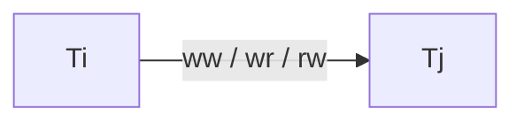

<div class="text-center">

An arrow **Ti → Tj** means: *Ti must come before Tj in any equivalent serial order.*

</div>

<!--
"Directly" refers to the next version, not any later version, so edges are only drawn between neighbours in
the version order. Transitive paths are handled by the graph.
-->

---

# Direct Serialization Graph (DSG)

```text
H_serial: w1(z1) w1(x1) w1(y1) w3(x3) c1 r2(x1) w2(y2) c2 r3(y2) w3(z3) c3
          [x1 ≪ x3, y1 ≪ y2, z1 ≪ z3]
```

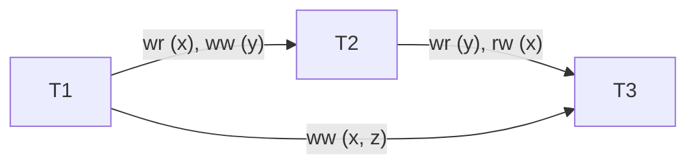

- One node per **committed** transaction. One arrow per direct dependency.
- Acyclic ⇒ a topological sort gives a serial order: **T1, T2, T3**

<div class="muted small">
Note: T3 wrote x3 before T1 committed. That is fine; only the committed result matters.
</div>

---

# Why predicates need special treatment

```sql
SELECT COUNT(*) FROM employees WHERE dept = 'Sales';
```

<div class="grid grid-cols-2 gap-6 mt-4">
<div class="box">

**What the query returns**

Only the matching rows, or just an aggregate.

</div>
<div class="box">

**What the model tracks: Vset(P)**

One version of **every** possible tuple in the relation, including non-matching, unborn and dead ones.

</div>
</div>

An INSERT can change the answer without overwriting any row the query returned. Unborn versions in Vset(P) are where phantoms come from.

<div class="muted small">

Predicate *writes* (UPDATE … WHERE) are modeled as a predicate read followed by ordinary item writes. There is no “predicate-ww” edge.

</div>

---

# Predicate dependency: a surprising edge

```text
w0(x0) c0  w1(x1) c1  w2(x2)  r3(Dept=Sales: x2, y0)  w2(y2) c2 c3     [x0 ≪ x1 ≪ x2, y0 ≪ y2]
```

<div class="grid grid-cols-2 gap-6">
<div>

- T0: inserts employee x in **Sales**
- T1: moves x to **Legal**
- T2: changes x’s **phone**
- T3: queries `Dept = Sales`, sees x2 (not a match)

</div>
<div>

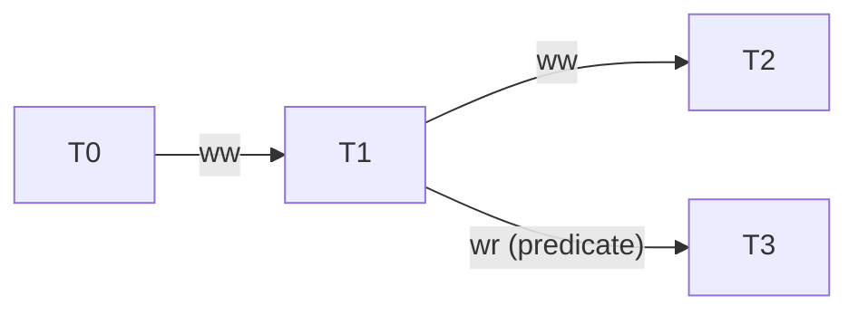

</div>
</div>

The edge is **T1 → T3**, not T2 → T3. T1 was the last transaction that changed *whether x matches*.
Serializable as **T0, T1, T3, T2**, even though T3 saw T2’s version.

---

# Predicate rw edges conflict less than predicate locks

<div class="grid grid-cols-2 gap-6">
<div class="box">

**2PL with predicate locks**

T1 reads `Dept = Sales`. T2 inserts a row covered by the lock and has to **wait**, even if the new row does not change the result.

</div>
<div class="box">

**Adya: predicate-anti-depends**

T1 **rw→** T2 only if T2 installs a later version that **changes the matches** of T1’s read: it inserts into Sales, moves a row in or out, or deletes a match.

</div>
</div>

- Item rw: the writer must produce the *very next* version.
- Predicate rw: *any later* version that changes the match set.
- This allows precision locks, index-range locks, SSI and similar techniques that conflict less.

---

# G0: write cycles · PL-1 forbids them

```text
H_wcycle: w1(x1,2) w2(x2,5) w2(y2,5) c2 w1(y1,8) c1        [x1 ≪ x2, y2 ≪ y1]
```

<div class="grid grid-cols-2 gap-6">
<div>

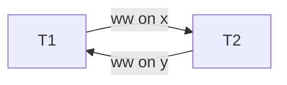

</div>
<div>

T1 comes before T2 on x, but T2 comes before T1 on y.

**PL-1** = no cycle made only of **ww** edges.

Unlike P0, G0 lets *uncommitted* transactions write the same object concurrently. Only the committed outcome must not interleave.

</div>
</div>

---

# Why forbid dirty writes at all?

The paper gives two reasons for P0:

1. **Simple undo recovery.** T1 writes x, T2 overwrites it, then T1 aborts. Restoring T1’s before-image would wipe out T2’s write.
   → *This depends on the implementation.* Systems that keep private versions (Thor, MVCC) do not have the problem.
2. **Serialize writers by their writes.** All of T1’s writes are before all of T2’s, or all after.
   → *This is the real reason.* G0 captures it.

PL-1 is still weak. Predicate updates can interleave:

```text
H_pred-update: w1(x1) r2(Dept=Sales: x1; y_init) w1(y1) w2(x2) c1 c2
```

<div class="grid grid-cols-2 gap-6">
<div>

T1 adds employees x and y to Sales. T2 gives Sales a raise and gets **x but not y**. This is allowed at PL-1: there is no ww cycle.

<div class="small muted mt-2">Dashed = predicate edges; PL-1 ignores them. The cycle they form is G2, forbidden only at PL-3.</div>

</div>
<div>

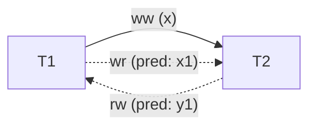

</div>
</div>

<!--
Answers the open question from the notes: "ANSI SQL isolation should be modified to require P0 for all
isolation levels — explain why". Reason 2 is what matters; Adya keeps it (G0) and drops the locking part.
-->

---

# G1: the three problems PL-2 forbids

<div class="box">

**G1a · aborted reads**: a committed transaction read a version written by a transaction that later **aborted**.
`w1(x1:i) … r2(x1:i) … (a1 and c2 in any order)`

</div>
<div class="box">

**G1b · intermediate reads**: a committed transaction read a version that was **not the writer’s final** version.
`w1(x1:i) … r2(x1:i) … w1(x1:j) … c2`

</div>
<div class="box">

**G1c · circular information flow**: the DSG has a cycle made only of **ww and wr** edges, with no rw edges. (G1c includes G0.)

</div>

Together: every committed read saw a state that existed, or will exist, in the committed database.

---

# G1c example: each one saw the other

Both start with x = 0, y = 0.

<div class="grid grid-cols-2 gap-8">
<div>

```text
T1: write x = 1
T2: write y = 1
T1: read y → 1     (T2's uncommitted write)
T2: read x → 1     (T1's uncommitted write)
T1: commit
T2: commit
```

```text
w1(x1) w2(y2) r1(y2) r2(x1) c1 c2
```

</div>
<div>


</div>
</div>

- No G1a (both commit) and no G1b (both read final versions), yet the result is impossible.
- In any serial order, the first transaction must read 0. Here both read 1.
- Only possible when uncommitted data can be read. That is why PL-2 needs G1c on top of G1a/G1b.

<!--
Locking RC: each read waits for the other's long write lock → deadlock, one aborts.
MVCC RC (Postgres): each reads the committed 0 → no cycle (edges become rw instead of wr).
G1c includes G0: a cycle of only ww edges is also a cycle of "ww or wr" edges.
-->

---

# PL-2 is weaker than “no dirty reads”

```text
H1': r1(x,5) w1(x,1) r1(y,5) w1(y,9) r2(x,1) r2(y,9) c1 c2
```

- T2 reads T1’s **uncommitted** values. P1 forbids this; G1 allows it, since T1 commits with those final values.
- Implementation cost: **T2’s commit has to wait for T1’s commit.** If T1 aborts, T2 must abort too (a **cascading abort**).
- Where this is useful: tentative commits on disconnected or mobile clients, and hot spots.

Locking implementation: long write locks + short read locks ⇒ G1a/G1b are impossible, and G1c follows.

<div class="muted small mt-4">

PL-2 gives **no** extra guarantees for predicate reads; they are treated like any other read.

</div>

---

# G2: anti-dependency cycles · PL-3 forbids them

<div class="grid grid-cols-2 gap-6">
<div>

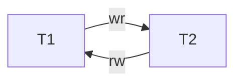

</div>
<div>

**G2**: the DSG has a cycle with **one or more rw** edges.

**PL-3 = forbid G1 + G2** ⇒ no cycles at all.

</div>
</div>

- Weaker than P2: Tj may overwrite x *after* an uncommitted Ti has read it. H1' and H2' are allowed.
- Gives **conflict-serializability**, which is what every real system provides.
- Constrains only **committed** transactions. A running transaction may see garbage, as long as it cannot commit.

---

# G2 example: T2 sees half of a transfer

T1 moves 4 from x to y. Invariant **x + y = 10**, start x = 5, y = 5. (Paper’s H2.)

<div class="grid grid-cols-2 gap-8">
<div>

```text
T2: read x → 5
T1: read x → 5, write x = 1
T1: read y → 5, write y = 9
T1: commit
T2: read y → 9      sum = 14  ✗
T2: commit
```

```text
r2(x0) r1(x0) w1(x1) r1(y0) w1(y1) c1 r2(y1) c2
```

</div>
<div>

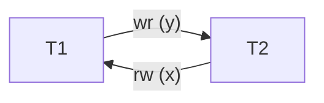

- **T2 –rw→ T1**: T2 read x0, T1 installed the next version x1
- **T1 –wr→ T2**: T2 read T1’s y1

</div>
</div>

No dirty read: everything T2 read was committed, so PL-2 allows it. The rw edge closes a cycle, so **PL-3 forbids it**.
If T2 had read y0 instead (H2'), only the rw edge remains: no cycle, serial order **T2 ; T1**.

---

# The isolation ladder

| Portable level | ANSI analogue | Forbids | Ti can commit only if… |
|---|---|---|---|
| **PL-1** | READ UNCOMMITTED | G0 | its writes are fully isolated from others’ writes |
| **PL-2** | READ COMMITTED | G1 (a, b, c) | it read only updates committed by the time Ti commits |
| **PL-2.99** | REPEATABLE READ | G1, G2-item | it is fully isolated for items; PL-2 guarantees for predicates |
| **PL-3** | SERIALIZABLE | G1, G2 | everything happened before or after every other transaction |

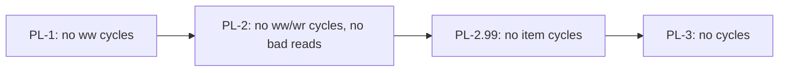

<div class="muted small">These are the paper’s proposed portable definitions, not a statement about any vendor’s labels.</div>

<style>
table { font-size: 0.8em; }
td, th { padding-top: 0.35rem; padding-bottom: 0.35rem; }
</style>

---

# Phantoms: why PL-2.99 is not PL-3

```text
H_phantom: r1(Dept=Sales: x0,10; y0,10) r1(x0,10) r2(y0,10) r2(Sum0,20)
           w2(z2,10) w2(Sum2,30) c2 r1(Sum2,30) c1          [Sum0 ≪ Sum2, z_init ≪ z2]
```

<div class="grid grid-cols-2 gap-6">
<div>

- **T1:** lists Sales employees (sum = 20), then reads the stored total.
- **T2:** inserts z into Sales and updates the stored total to 30. Commits.
- T1 reads 30 ≠ 20 → **inconsistent**.

</div>
<div>

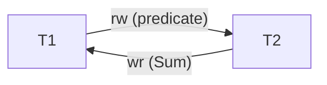

</div>
</div>

The cycle exists **only** because of the predicate rw edge. G2 catches it; G2-item does not.

---

# Phantom example in SQL

Sales has x and y (salary 10 each). A stored `dept_total` row says 20.

```text
T1: SELECT sum(salary) FROM emp WHERE dept = 'Sales'          → 20
T2: INSERT INTO emp VALUES ('z', 'Sales', 10)
T2: UPDATE dept_total SET total = 30 WHERE dept = 'Sales'
T2: COMMIT
T1: SELECT total FROM dept_total WHERE dept = 'Sales'          → 30 ≠ 20  ✗
```

<div class="grid grid-cols-2 gap-8">
<div>

- **No item rw edge**: nothing T1 read (x, y) was overwritten.
- **T1 –rw (predicate)→ T2**: z did not exist yet, but now matches T1’s query.
- **T2 –wr→ T1**: T1 read T2’s total.

</div>
<div>

The cycle needs the predicate edge, so **PL-2.99 allows it** and **PL-3 forbids it**.

Locking RR: long locks on rows read, short lock on the predicate, so the INSERT is not blocked.

</div>
</div>

<!--
Real systems: Postgres RR (snapshot isolation) reads the total from T1's snapshot → 20, no anomaly here.
MySQL InnoDB RR: plain SELECTs also use a snapshot; locking reads (FOR SHARE / FOR UPDATE) take next-key
(gap) locks, which would block T2's INSERT. The "classic" phantom exists in lock-based RR without gap locks.
-->

---
zoom: 0.92
---

# Mixed isolation levels

Each transaction declares its own level. Build a **Mixed Serialization Graph (MSG)**:

- **ww** edges: always kept (they matter at every level)
- **wr** edges *into* PL-2 / PL-3 transactions
- **rw** edges *out of* PL-3 transactions (**obligatory conflicts**, even when the other side is PL-1)

<div class="box mt-4">

**Check:** build the MSG. It must have no cycles, and PL-2 / PL-3 transactions must not have read aborted or intermediate versions.

**Promise (Mixing Theorem):** if the check passes, every transaction gets the guarantees of its own level, even when it runs alongside lower-level transactions.

</div>

A PL-3 transaction is no magic fix. If lower-level code writes inconsistent data, PL-3 will faithfully read that inconsistent data.

---

# Mixed levels example: same history, different verdict

T2 runs at **PL-1** and moves money from x to y. T1 reads x, then y.

```text
r1(x0)  w2(x2) w2(y2) c2  r1(y2) c1
```

<div class="grid grid-cols-2 gap-8">
<div>

**T1 at PL-3**: not mixing-correct

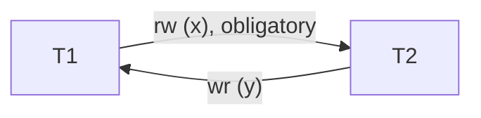

The rw edge leaves a PL-3 transaction, so it stays in the MSG even though T2 is PL-1. Cycle → rejected.

</div>
<div>

**T1 at PL-2**: mixing-correct

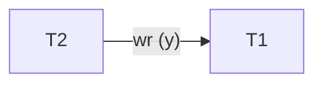

rw edges out of PL-2 transactions are dropped. No cycle → allowed. T1 read only committed data, which is all PL-2 promises.

</div>
</div>

<!--
Paper §5.5, Definition 9 and the Mixing Theorem. Footnote 1: a PL-3 transaction is protected against
concurrency, not against inconsistent data written earlier by lower-level transactions.
-->

---
layout: section
---

# Beyond the paper

Connecting Adya’s framework to DDIA and to real databases


---
zoom: 0.88
---

# Common anomalies as cycle shapes

From Adya’s 1999 PhD thesis and the Hermitage test suite:

| Anomaly | Shape in the DSG | Forbidden by |
|---|---|---|
| Dirty write (G0) | ww-only cycle | PL-1 |
| Dirty / aborted read (G1a, G1b) | not a cycle: reading a bad version | PL-2 |
| **Lost update (P4)** | `T1 –ww→ T2 –rw→ T1` | SI, PL-2.99 |
| **Read skew (G-single)** | cycle with **exactly one** rw edge | SI, PL-2.99 |
| **Write skew (G2-item)** | cycle with **two or more** item rw edges | PL-2.99 |
| **Phantom (G2)** | cycle needing a predicate rw edge | PL-3 |

<div class="small muted">G-single = “single anti-dependency cycle”. Snapshot isolation forbids it; that is the formal sense in which SI prevents read skew.</div>

---

# Read skew vs write skew

<div class="grid grid-cols-2 gap-8">
<div>

**Read skew** (G-single)

```text
r1(x0) w2(x2) w2(y2) c2 r1(y2) c1
```


T1 sees x before T2 and y after T2.
<span class="accent">One rw edge</span>: SI prevents it, because T1 would read y0 from its snapshot.

</div>
<div>

**Write skew** (G2-item), DDIA’s on-call doctors

```text
r1(alice,bob) r2(alice,bob)
w1(alice=off) w2(bob=off) c1 c2
```

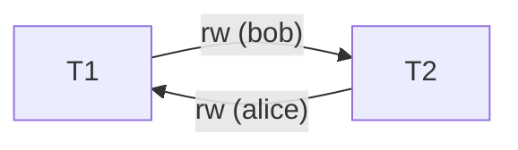

<span class="accent">Two rw edges</span>: SI allows it, since the write sets do not overlap.

</div>
</div>

<!--
This answers the original deck's discussion prompt: "What graph would a write-skew execution produce?"
-->

---
zoom: 0.88
---

# Snapshot Isolation in Adya’s terms

The ICDE paper only mentions SI. The thesis defines **PL-SI**:

- Uses a **Start-ordered Serialization Graph (SSG)**: the DSG plus *start-dependency* edges
  (Ti committed before Tj started).
- **PL-SI = forbid G1 + G-SI**
  - **G-SIa (interference):** a ww/wr edge with no matching start-dependency. Tj saw Ti’s work without starting after Ti committed.
  - **G-SIb (missed effects):** a cycle with **exactly one** rw edge.

Consequences:

- SI is **incomparable** with ANSI REPEATABLE READ (PL-2.99). SI allows write skew; PL-2.99 forbids G2-item. SI prevents some predicate anomalies that PL-2.99 allows.
- This is one reason “repeatable read” means different things in different products, as DDIA says.

---

# From “detect cycles” to SSI (PostgreSQL SERIALIZABLE)

**Theorem (Fekete et al., 2005):** every cycle under SI contains two *consecutive* rw edges between concurrent transactions.

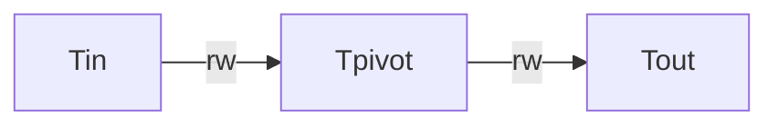

- SSI (Cahill 2008; PostgreSQL 9.1, Ports & Grittner 2012) tracks rw edges using **SIRead locks**, which do not block anyone.
- If a “dangerous structure” (a pivot with rw in and rw out) appears, one transaction is aborted.
- This is conservative: some aborts are false positives. It never blocks, and it gives PL-3.

<div class="muted small mt-2">

This is Adya’s idea put to work: let operations overlap, and look at the *dependency graph* of committed transactions.

</div>

---
zoom: 0.88
---

# What PostgreSQL actually provides

<div class="small">

| PG level | Adya-style level | Prevents | Still allows |
|---|---|---|---|
| READ COMMITTED | ≈ PL-2 (statement-level snapshots) | G0, G1a, G1b, G1c | lost update, read skew, write skew, phantoms |
| REPEATABLE READ | **Snapshot Isolation** | + lost update (abort on concurrent update), read skew | write skew (G2-item), G2 |
| SERIALIZABLE | **SSI** ⇒ PL-3 | everything | — (but expect serialization failures) |

</div>

- Writing to an uncommitted row blocks (row lock), so PG forbids P0 itself, not just G0.
- `could not serialize access…` (SQLSTATE 40001) **is the cycle detector firing**. Retry the transaction.
- Tooling based on Adya’s vocabulary:
  - **Hermitage** (Kleppmann): per-DB tests named G0, G1a, G1b, G1c, OTV, PMP, P4, G-single, G2-item, G2
  - **Jepsen / Elle**: infers the DSG from real histories and searches it for these cycles

<!--
Ties back to the chapter notes: retrying failed transactions makes sense for 40001 / deadlock errors, but not
for constraint violations.
-->

---

# What the framework does *not* cover

- **Running transactions.** The guarantees apply only at commit. An OCC transaction can observe an
  inconsistent state while it runs (a “zombie”), divide by zero, and then abort. The thesis adds variants for running transactions.
- **Real time.** PL-3 says nothing about wall-clock order. *Strict* serializability / linearizability (DDIA ch. on consistency) are separate.
- **View-serializable histories** that are not conflict-serializable are rejected. In practice this costs nothing.
- **Intermediate levels** (Cursor Stability, PL-2+ / causal consistency, SI) are in the thesis, not in this paper.
- **The history is an abstraction.** You need a version order. In black-box testing (Elle) that order has to be *inferred*.

---

# Takeaways

- Isolation should describe **allowed outcomes**, not require a locking mechanism.
- **Committed versions and their order** are central to the model.
- **ww / wr / rw** edges encode who must logically come before whom.
- Predicates create dependencies even for rows that **never matched**.
- Levels = which **cycle shapes** are forbidden. PL-3 forbids all of them.
- SI, SSI, Hermitage and Elle all build on this vocabulary.

---

# Discussion

1. Draw the DSG for a **lost update** (two increments of a counter). Which level forbids it, and why is it not G0?
2. Why does SI forbid G-single but allow G2-item? What does that say about checking **write–write conflicts only**?
3. PG REPEATABLE READ never shows phantoms in `SELECT`. Is it PL-3 then? Find a counterexample.
4. G1 allows reading uncommitted data. Would you want this anywhere outside mobile or offline systems?
5. Your app runs most transactions at READ COMMITTED and one critical job at SERIALIZABLE. What does the *Mixing Theorem* promise, and what does it not?

<!--
1: T1 r(x0) T2 r(x0) T1 w(x1) c1 T2 w(x2) c2 → T1 ww→ T2, T2 rw→ T1 (T2 read x0, T1 installed next version x1).
   One rw edge → G-single, forbidden by PL-2.99 and SI. Not G0: only one ww edge, the cycle needs rw.
3: Write skew (doctors) under PG RR: no phantom is visible, but there is a G2-item cycle → not serializable.
   Also the read-only anomaly (Fekete, O'Neil, O'Neil 2004).
5: Mixing Theorem: the SERIALIZABLE job gets PL-3 relative to the data it sees, but if RC code wrote
   inconsistent data, it will read it consistently-wrong (paper footnote 1).
-->

---

# Sources & further reading

**Primary paper**
Adya, Liskov & O’Neil. *Generalized Isolation Level Definitions.* ICDE 2000.

**Background**
- Berenson, Bernstein, Gray, Melton, E. O’Neil, P. O’Neil. *A Critique of ANSI SQL Isolation Levels.* SIGMOD 1995.
- Adya. *Weak Consistency: A Generalized Theory and Optimistic Implementations for Distributed Transactions.* PhD thesis, MIT, 1999.

**Follow-ups**
- Fekete, Liarokapis, E. O’Neil, P. O’Neil, Shasha. *Making Snapshot Isolation Serializable.* TODS 2005.
- Cahill, Röhm, Fekete. *Serializable Isolation for Snapshot Databases.* SIGMOD 2008.
- Ports, Grittner. *Serializable Snapshot Isolation in PostgreSQL.* VLDB 2012.
- Kleppmann. *Hermitage* — github.com/ept/hermitage
- Kingsbury, Alvaro. *Elle: Inferring Isolation Anomalies from Experimental Observations.* VLDB 2020.

<div class="muted small mt-4">Examples are adapted and simplified. The formal definitions are in the paper.</div>
